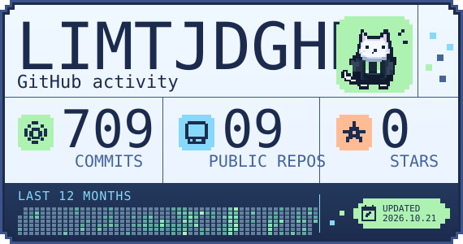
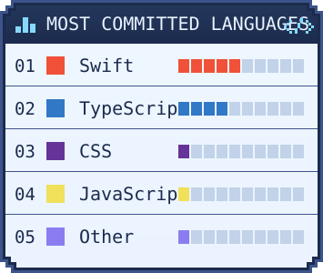

<div align="center">

# GitHub Pixel Stats

**Pixel-art GitHub stats cards for your profile README.**<br>
No sign-up, no token, no fork — just your username in a URL.

[](https://github.com/limtjdghks/github-pixel-stats/actions/workflows/ci.yml)
[](LICENSE)




</div>

> [!NOTE]
> The hosted service is launching soon. Until then, `<service-host>` in the examples below is a placeholder for its domain.

## Features

- **Just a URL.** Put your GitHub username in the card URL and you are done. There is nothing to install, authorize or keep running.
- **Pixel-art look.** Stepped pixel frames, the NeoDunggeunmo Pro pixel typeface and a white cat in a dark hoodie.
- **Your year at a glance.** Commits over the last 12 months with a grid of one cell per day, alongside your public repositories and stars.
- **Languages you actually write.** Languages are ranked by the commits that touch them, not by bytes of code, and drawn as 10-segment bars.
- **A card instead of a broken image.** New usernames get a friendly placeholder card, problems show a short status card, and if an update fails your last good card stays up.
- **Public data only.** Only public repositories are read. Nothing private is collected, and you can ask for your data to be removed.

## Quick start

Add these lines to your profile README and replace `<username>` with your GitHub username.

```html
/<username>/stats.svg" width="570" alt="<username>'s GitHub activity" />
/<username>/languages.svg" width="355" alt="<username>'s most committed languages" />
```

Prefer Markdown?

```markdown


```

The two cards are independent, so you can use either one alone. Keep both images in the same paragraph to show them side by side.

The first time a username is requested, the card says **PREPARING** while its stats are collected. This can take a while, especially for very active accounts, so check back later.

## Customization

### Mascot

Choose the mascot on the stats card with the `mascot` query parameter.

```text
https://<service-host>/<username>/stats.svg?mascot=cat
```

| ID | Mascot |
| --- | --- |
| `cat` (default) | A white cat in a dark hoodie |

Only the cat is available today, so you can leave the parameter out. Unknown IDs fall back to the cat. Want to draw a new mascot? See [CONTRIBUTING.md](CONTRIBUTING.md#adding-a-mascot).

## How it works

1. Your README asks the service for `/<username>/stats.svg`.
2. If cards for that username are already published, they are returned from the CDN.
3. If not, you get a PREPARING card, and the service starts collecting public activity from the GitHub API in the background.
4. Collected stats are rendered into SVG cards, validated, and published. A scheduled job keeps published cards up to date.

Nothing is rendered while your README loads, so the cards stay fast no matter how much history an account has.

## FAQ

<details>
<summary><b>What counts as a commit?</b></summary>

Commits authored by you in public repositories during the last 12 months, on each repository's default branch. Stars count only repositories you own that are not forks. If GitHub refuses to show a commit's changed files (for example, because the repository's organization restricts token access, or the commit was removed), the commit still counts but adds no language.
</details>

<details>
<summary><b>Why do the language bars add up to more than 10 segments?</b></summary>

A commit counts once for every language whose files it changes, so one commit can count for several languages. Each bar shows that language's share of all language counts, rounded to a whole number of its 10 segments. Every language shown gets at least one segment, even if its share is under 10%, so small languages stay visible. Because of this minimum and the rounding, the bars can add up to more than 10 segments.
</details>

<details>
<summary><b>My card shows a message instead of stats. What does it mean?</b></summary>

| Message | Meaning |
| --- | --- |
| PREPARING | Stats are being collected. Check back later. |
| NO STATS | Stats could not be built, usually because the username does not exist. |
| AT CAPACITY | The service is not accepting new usernames right now. Try again later. |
| REMOVED | The account owner asked for the stats to be removed. |
| INVALID USER | The URL does not contain a valid GitHub username. |
| UNAVAILABLE | The service is temporarily unavailable. |
</details>

<details>
<summary><b>Why hasn't my card changed yet?</b></summary>

Cards are cached by the service's CDN, by browsers and by GitHub's image proxy, so an update can take a while to show up.
</details>

## Privacy

Cards are built only from public GitHub data, and the service sets no cookies and does not track people who view your README. See [PRIVACY.md](PRIVACY.md) for what is stored, how long it is kept, and how to have your data removed.

## Contributing

Bug reports, ideas and pull requests are welcome, and so are new mascots. See [CONTRIBUTING.md](CONTRIBUTING.md) to get started.

## Credits

- Pixel typeface: [NeoDunggeunmo Pro](https://github.com/neodgm/neodgm-pro-webfont) by Eunbin Jeong (SIL Open Font License 1.1)
- Language names and colors: [GitHub Linguist](https://github.com/github-linguist/linguist) (MIT)

## License

GitHub Pixel Stats is released under the [MIT License](LICENSE). The bundled font and language data keep their own licenses; see [third_party/README.md](third_party/README.md).
